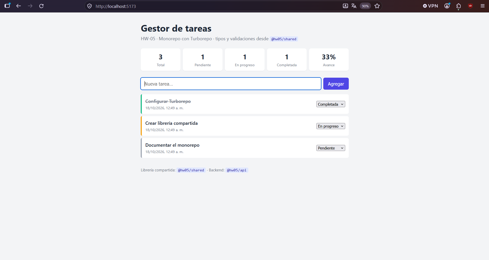
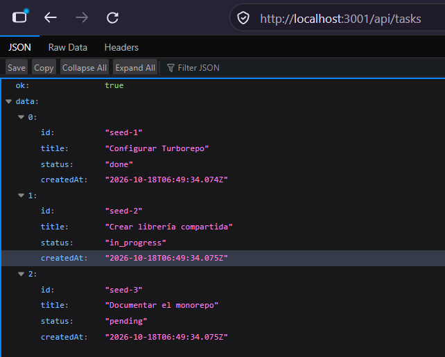
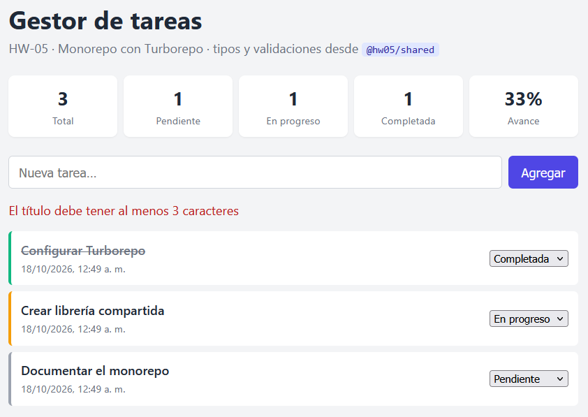

# Arquitectura-De-Sistemas
## Presentación Personal

* **Nombre:** Ebal Isai Juarez Gonzalez
* **Carnet:** 202408025
* **Semestre:** 6to Semestre

---

# HW-05 · Monorepo con Turborepo

Monorepo que contiene **dos aplicaciones** (frontend y backend) y **una librería compartida** utilizada por ambas, administradas desde un único repositorio con **Turborepo** y **npm workspaces**.

La aplicación de ejemplo es un **gestor de tareas**:

- **`apps/api`**: API REST (Express + TypeScript) que expone las tareas.
- **`apps/web`**: interfaz web (React + Vite + TypeScript) que consume la API.
- **`packages/shared`**: tipos y utilidades (`Task`, `TaskStatus`, `ApiResponse`, `validateTaskTitle`, `summarizeTasks`, `formatDate`, `TASK_STATUS_LABELS`) que usan **ambas** aplicaciones. Así, la regla para validar un título es exactamente la misma en el cliente y en el servidor.

## Estructura del monorepo

```text
.
├── apps/                      # Aplicaciones desplegables
│   ├── api/                   # @hw05/api  → Backend Express (puerto 3001)
│   │   ├── src/
│   │   │   ├── app.ts         # Definición de rutas (usa @hw05/shared)
│   │   │   ├── app.test.ts    # Pruebas con Vitest + Supertest
│   │   │   └── index.ts       # Punto de entrada (levanta el servidor)
│   │   ├── package.json
│   │   └── tsconfig.json
│   └── web/                   # @hw05/web  → Frontend React + Vite (puerto 5173)
│       ├── src/
│       │   ├── App.tsx        # UI principal (usa @hw05/shared)
│       │   ├── App.test.tsx   # Pruebas con Vitest + Testing Library
│       │   ├── api.ts         # Cliente HTTP tipado con @hw05/shared
│       │   └── main.tsx
│       ├── index.html
│       ├── vite.config.ts     # Proxy /api → http://localhost:3001
│       └── package.json
├── packages/                  # Código compartido
│   └── shared/                # @hw05/shared → Tipos y utilidades
│       ├── src/
│       │   ├── types.ts
│       │   ├── utils.ts
│       │   ├── utils.test.ts
│       │   └── index.ts
│       └── package.json
├── package.json               # Workspaces y scripts globales
├── turbo.json                 # Pipeline de tareas de Turborepo
└── tsconfig.base.json         # Configuración de TypeScript común
```

Cada aplicación declara la librería como dependencia (`"@hw05/shared": "*"`), y npm workspaces la enlaza localmente en `node_modules`. No hace falta publicarla en ningún registro.

## Herramienta elegida: Turborepo

Elegí **Turborepo** (junto con **npm workspaces** para la gestión de dependencias) por estas razones:

| Criterio | Justificación |
| --- | --- |
| **Orquestación por dependencias** | En `turbo.json`, `"dependsOn": ["^build"]` hace que `@hw05/shared` se compile siempre **antes** que `api` y `web`, sin tener que ordenar los comandos a mano. |
| **Caché de tareas** | Turborepo guarda los resultados de `build`, `test` y `typecheck`. Si un paquete no cambió, reutiliza la salida (`cache hit`) y la ejecución es casi instantánea. |
| **Ejecución en paralelo** | Las tareas independientes (por ejemplo, `test` de `api` y de `web`) se ejecutan en paralelo y aprovechan todos los núcleos. |
| **Filtrado** | Con `--filter=@hw05/web` se puede ejecutar una sola aplicación (y sus dependencias), lo que permite trabajar con cada app por separado. |
| **Configuración mínima** | Solo necesita un `turbo.json` y se apoya en los scripts de cada `package.json`. No impone estructura ni generadores, a diferencia de herramientas más pesadas como Nx. |
| **Sin herramientas extra** | Funciona con npm workspaces, que ya viene con Node.js, así que no hay que instalar pnpm ni yarn. |

## Requisitos previos

- [Node.js](https://nodejs.org/) **20 o superior** (probado con Node 26)
- npm **10 o superior** (incluido con Node.js)
- Git

## Pasos para ejecutar el proyecto desde cero

```bash
# 1. Clonar el repositorio y entrar en la rama de la entrega
git clone https://github.com/EbalJuarez/Arquitectura-De-Sistemas.git
cd Arquitectura-De-Sistemas
git checkout hw-05

# 2. Instalar las dependencias de todos los workspaces (una sola vez, desde la raíz)
npm install

# 3. Compilar todo (shared → api y web)
npm run build

# 4. Ejecutar las pruebas de todo el monorepo
npm test

# 5. Levantar el entorno de desarrollo (API + Web a la vez)
npm run dev
```

Después abre:

- Frontend: <http://localhost:5173>
- API: <http://localhost:3001/api/tasks>

> En desarrollo, el frontend redirige las peticiones de `/api` al backend mediante el proxy de Vite. Por eso hay que levantar **ambas** aplicaciones (lo hace `npm run dev`).

## Comandos disponibles (desde la raíz)

### Para todo el monorepo

| Comando | Descripción |
| --- | --- |
| `npm install` | Instala las dependencias de todas las apps y librerías. |
| `npm run dev` | Levanta **api** y **web** en modo desarrollo, con recarga en caliente. |
| `npm run build` | Compila todos los paquetes en orden (`shared` → `api`, `web`). |
| `npm test` | Ejecuta las pruebas de todos los paquetes (Vitest). |
| `npm run typecheck` | Verifica los tipos de TypeScript en todo el monorepo. |
| `npm start` | Compila y ejecuta las versiones de producción de **api** y **web**. |
| `npm run clean` | Elimina las carpetas `dist/` y `.turbo/`. |

### Para cada aplicación por separado

| Comando | Descripción |
| --- | --- |
| `npm run dev:api` | Levanta solo el backend en desarrollo (`http://localhost:3001`). |
| `npm run dev:web` | Levanta solo el frontend en desarrollo (`http://localhost:5173`). |
| `npm run build:api` | Compila solo el backend (y la librería compartida). |
| `npm run build:web` | Compila solo el frontend (y la librería compartida). |
| `npm run start:api` | Ejecuta la versión compilada del backend. |
| `npm run start:web` | Sirve la versión compilada del frontend (`http://localhost:4173`). |
| `npm run test:api` | Pruebas solo del backend. |
| `npm run test:web` | Pruebas solo del frontend. |
| `npm run test:shared` | Pruebas solo de la librería compartida. |

> Todos los comandos por aplicación usan `turbo run <tarea> --filter=<paquete>`, así que Turborepo compila primero `@hw05/shared` si hace falta.

## Endpoints de la API

| Método | Ruta | Descripción |
| --- | --- | --- |
| `GET` | `/api/health` | Estado del servicio. |
| `GET` | `/api/tasks` | Lista de tareas. |
| `GET` | `/api/tasks/summary` | Resumen calculado con `summarizeTasks` de `@hw05/shared`. |
| `POST` | `/api/tasks` | Crea una tarea (`{ "title": "..." }`), validada con `validateTaskTitle`. |
| `PATCH` | `/api/tasks/:id` | Cambia el estado (`{ "status": "pending" \| "in_progress" \| "done" }`). |

## Uso de la librería compartida

| Elemento de `@hw05/shared` | `apps/api` | `apps/web` |
| --- | :---: | :---: |
| Tipos `Task`, `TaskStatus`, `ApiResponse` | ✅ | ✅ |
| `validateTaskTitle` | ✅ valida el `POST` | ✅ valida el formulario |
| `summarizeTasks` | ✅ `/api/tasks/summary` | ✅ tarjetas de resumen |
| `createTask` / `isTaskStatus` | ✅ | — |
| `formatDate` / `TASK_STATUS_LABELS` | — | ✅ |

## Capturas de pantalla

### Frontend (`apps/web`)



### Backend (`apps/api`)



### Validación compartida en ambas aplicaciones



## Convención de commits

Los commits siguen la especificación [Conventional Commits](https://www.conventionalcommits.org/es/v1.0.0/), por ejemplo:

- `chore: inicializar monorepo con Turborepo y npm workspaces`
- `feat(shared): agregar librería compartida de tipos y utilidades`
- `feat(api): agregar backend con Express que usa la librería compartida`
- `feat(web): agregar frontend con React que consume la API y la librería compartida`
- `docs: documentar estructura del monorepo, herramienta y comandos`
- `docs: agregar capturas de pantalla de ambas aplicaciones`
